<!-- Generated by scripts/update_profile.py -->

[Apartment-Database](https://github.com/KaiAlexander-commits/Apartment-Database) · [Employee-Manager-Server](https://github.com/KaiAlexander-commits/Employee-Manager-Server) · [Trading-Algo](https://github.com/KaiAlexander-commits/Trading-Algo) · [Employee-Manager-Dashboard](https://github.com/KaiAlexander-commits/Employee-Manager-Dashboard) · [Final-Project](https://github.com/KaiAlexander-commits/Final-Project)

[GitHub](https://github.com/KaiAlexander-commits) · [Refresh status](https://github.com/KaiAlexander-commits/KaiAlexander-commits/actions/workflows/profile.yml)

Price = trailing 30-day GitHub contributions ÷ 10. Weekly candles show opening, highest, lowest and closing values of that activity index; volume is actual weekly contributions. Refreshes every six hours, subject to GitHub scheduling delays. Language shares exclude forks, this profile and the standalone Employee API copy. Holdings marked recent were pushed within 30 days.

