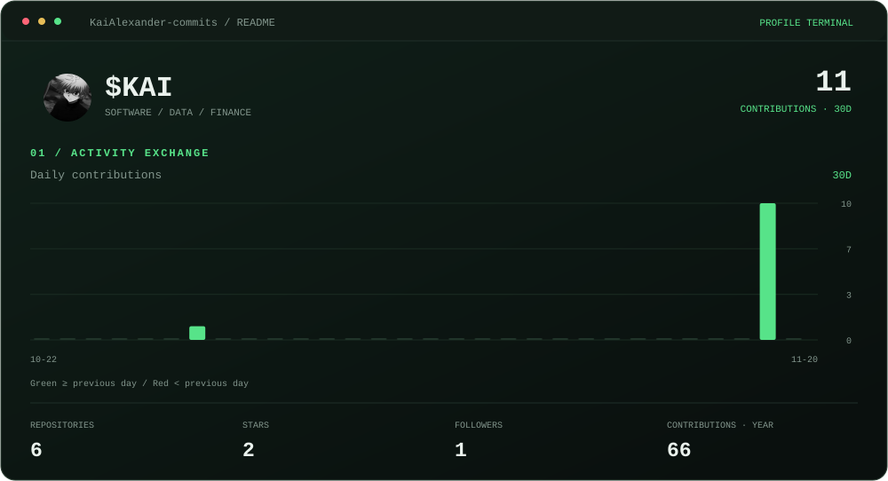
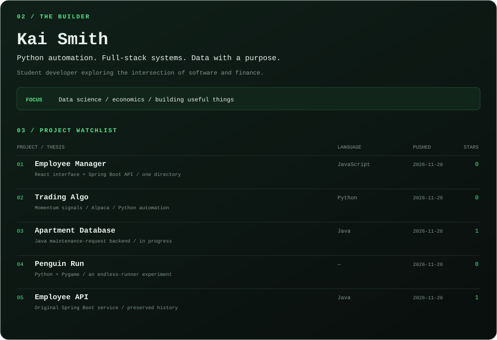
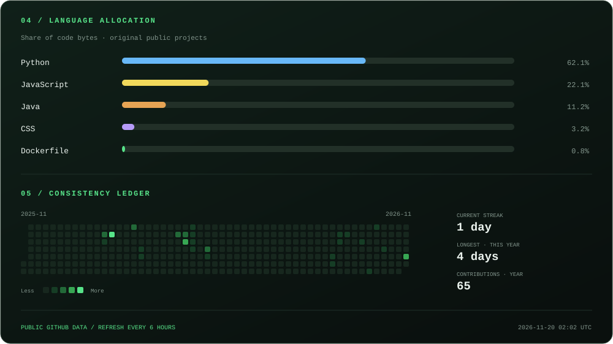

<!-- Generated by scripts/update_profile.py. Personal copy is in the renderer; public stats update automatically. -->

[Employee Manager](https://github.com/KaiAlexander-commits/Employee-Manager-Dashboard) · [Trading Algo](https://github.com/KaiAlexander-commits/Trading-Algo) · [Apartment Database](https://github.com/KaiAlexander-commits/Apartment-Database) · [Penguin Run](https://github.com/KaiAlexander-commits/Final-Project) · [Employee API](https://github.com/KaiAlexander-commits/Employee-Manager-Server)

[GitHub](https://github.com/KaiAlexander-commits) · [All projects](https://github.com/KaiAlexander-commits?tab=repositories) · [Refresh status](https://github.com/KaiAlexander-commits/KaiAlexander-commits/actions/workflows/profile.yml)

Built from my public GitHub activity. Scheduled refresh every six hours; GitHub may delay scheduled runs. Language shares exclude forks, this profile, and the standalone Employee API copy. Streaks use the displayed calendar; an active yesterday streak carries through today.

